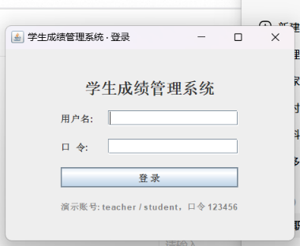
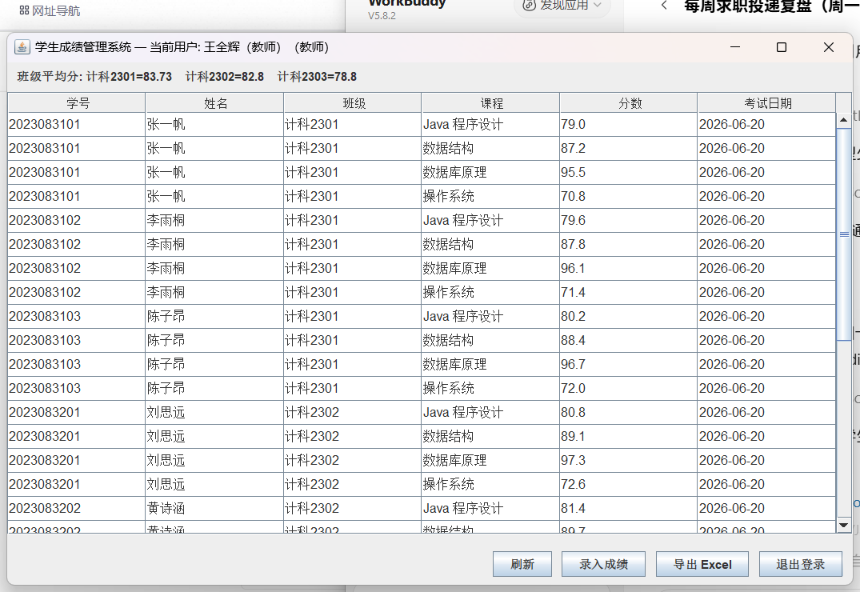
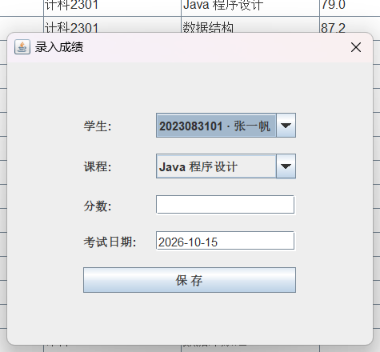
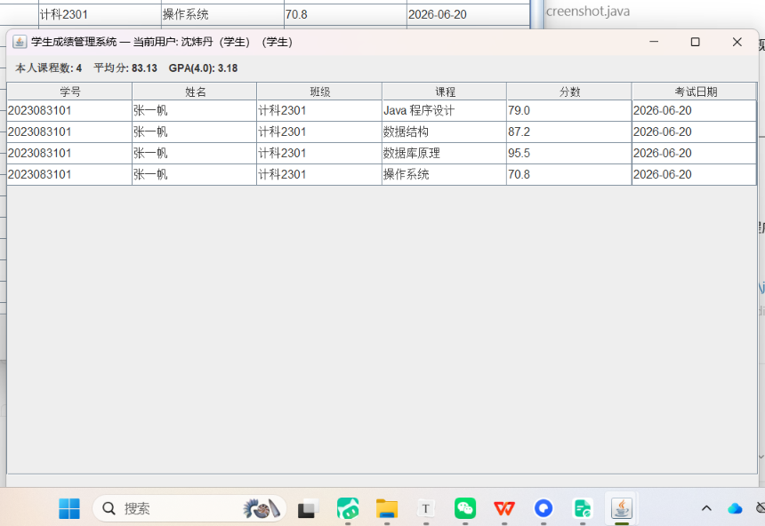
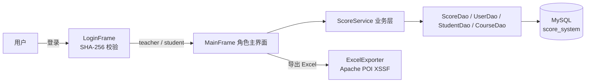

# 学生成绩管理系统 v2.0（Java · Swing GUI · MySQL · Apache POI）

一个分层架构的桌面版学生成绩管理系统：**Swing 图形界面 + 登录角色权限 + MySQL 持久化 + Excel 一键导出**，附 JUnit 单元测试与 Maven 构建脚本。

   

## 界面预览

| 登录 | 教师端主界面 |
|---|---|
|  |  |

| 录入成绩（仅教师） | 学生端（只读 + GPA 统计） |
|---|---|
|  |  |

## 功能特性

- **图形界面（Swing）**：登录窗口 → 角色主界面，JTable 成绩明细 + 顶部统计栏 + 底部操作栏。
- **登录与角色权限**：口令以 **SHA-256 摘要**存储于 MySQL；`teacher` 可查看全部 / 录入成绩 / 导出总表，`student` 仅可查看本人成绩单并导出，按钮按角色动态渲染。
- **MySQL 持久化**：`scores / students / courses / users` 四表外键关联，班级平均、课程平均用 SQL `AVG` 聚合；教师录入不存在的学生时自动建档（事务 + `INSERT ... ON DUPLICATE KEY UPDATE` 幂等）。
- **Excel 导出（Apache POI · XSSF）**：两个工作表（成绩明细 / 班级统计），表头样式 + 分数 0.0 格式 + 自动列宽。
- **可复现统计逻辑**：平均分 / 按学生汇总 / 并列排名 / 4.0 分段 GPA 均为**纯函数**，配套 JUnit 测试（不依赖数据库）。

## 架构



```
src/main/java/com/swd/score/
├── model/     Student / Course / Score / ScoreView / User
├── dao/       Database(连接管理) · User · Student · Course · Score 四个 DAO
├── service/   ScoreService：鉴权 + 查询 + 统计（纯函数可单测）
├── excel/     ExcelExporter（POI 双工作表导出）
├── gui/       LoginFrame · MainFrame(含录入对话框) · DemoScreenshot
└── Main.java  gui / --export / --stats / --demo-shot 四种入口
```

## 快速开始

### 1. 准备数据库

```bash
mysql -uroot -p < src/main/resources/schema_mysql.sql
# 自动建库 score_system + 种子数据（8 名学生 × 4 门课 = 32 条成绩）
# 演示账号：teacher / 123456，student / 123456
```

### 2. 配置连接（口令不入库）

在工作目录创建 `db.local.properties`（已被 .gitignore 排除）：

```properties
db.url=jdbc:mysql://localhost:3306/score_system?useSSL=false&allowPublicKeyRetrieval=true&serverTimezone=Asia/Shanghai&characterEncoding=utf8
db.user=root
db.password=你的口令
```

或用环境变量 `DB_USER` / `DB_PASS` 注入。

### 3. 构建 & 运行

```bash
mvn compile                                 # 或直接 javac（Java 21）
mvn exec:java -Dexec.mainClass=com.swd.score.Main   # 启动图形界面

# 命令行模式
java -cp target/classes com.swd.score.Main --export 成绩总表.xlsx   # 导出 Excel
java -cp target/classes com.swd.score.Main --stats                # 打印班级/课程/排名统计
```

## 设计取舍

| 决策 | 理由 |
|---|---|
| 口令存 SHA-256 而非明文 | 即使数据库泄露也不能直接还原口令（生产环境应再加盐/BCrypt，README 明确说明局限） |
| 权限在服务层校验、界面按角色渲染 | 学生即便绕过界面也拿不到他人数据入口（教学项目取舍：未做服务端会话） |
| `ON DUPLICATE KEY UPDATE` 录入 | 同一学生同一课程重复录入只保留最新，天然幂等 |
| 统计逻辑纯函数化 | 不连数据库即可单测，CI 友好 |
| `db.local.properties` 分离 | 真实口令永不进入版本库 |

## 局限与改进方向

- [ ] BCrypt 加盐替代裸 SHA-256
- [ ] 接入连接池（HikariCP）
- [ ] 导出 .xls / CSV 双格式
- [ ] 学分表启用后 GPA 改为加权计算

## 许可证

[MIT](LICENSE)
